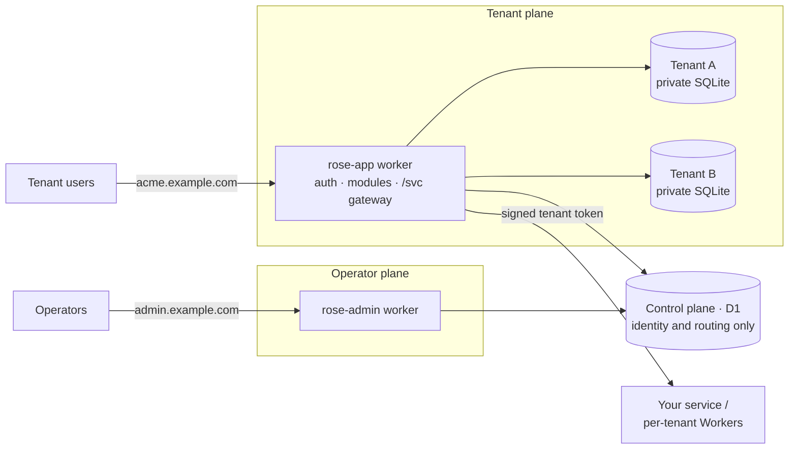

<p align="center">
  
</p>

<p align="center"><strong>Security-first multi-tenant SaaS starter kit for Cloudflare,<br>built so AI agents can extend it without breaking it.</strong></p>

---

Rose turns a product idea, or a service you already run, into a multi-tenant SaaS on
[Cloudflare for Platforms](https://developers.cloudflare.com/cloudflare-for-platforms/).
Tenant isolation, authentication, encryption, an operator console and a tenant app are
done. You add your product as small **modules**, and the kit's guardrails keep every
change, human or AI-written, inside the security model.

## 60-second start

```sh
git clone https://github.com/kalahroudi/rose.git && cd rose
pnpm install
pnpm dev
```

No Cloudflare account or configuration needed. Then open:

| | |
|---|---|
| **Operator console** | http://localhost:5173 — sign in as `admin@example.com` |
| **Tenant app** | http://localhost:5174 — sign up, create a workspace |
| **A workspace** | http://`<slug>`.localhost:5174 |

Sign-in codes are shown on screen in development.

## What you get

**Isolation by construction**
- Every tenant has its **own SQLite database** (a Durable Object). There is no shared
  table to leak from, so a forgotten `WHERE tenant_id` can not cross tenants.
- The tenant is decided by the request host only. Sessions, passkeys, API keys and
  sign-in codes are each bound to one tenant and rejected everywhere else.
- The operator console runs in a **separate Worker with no access path to tenant data**.

**Modern authentication**
- Passkeys (WebAuthn) and emailed one-time codes. No passwords.
- Host-bound `__Host-` session cookies, server-side sessions, CSRF protection, rate limits.
- Self-service signup, invitations, roles (owner / admin / member), scoped API keys.

**Encryption**
- Per-tenant data keys wrapped by a master key (envelope encryption, AES-256-GCM).
- One-line field encryption bound to tenant and column; blind indexes for exact search.
- Deleting a tenant destroys its key: crypto-shredding.

**Two finished apps, one UI kit**
- **Operator console**: tenants, custom domains (Cloudflare for SaaS), operators, audit,
  background activity, live setup health.
- **Tenant app**: onboarding, members and invitations, API keys, audit log, settings,
  and an example **Contacts** module to copy.
- Consistent shell, drawers, paginated tables, confirmations, light/dark, in-app help.

**Multi-tenant any service**
- A `/svc` gateway forwards authenticated requests to your existing service with a
  short-lived signed tenant token, or to per-tenant Workers (Workers for Platforms).

**Built for AI agents**
- `AGENTS.md` / `CLAUDE.md`, skills, and hooks that run the guard after every edit.
- `pnpm guard`: static rules that explain *why* and *how to fix*.
- An isolation test contract that automatically covers every new module.
- A hash-locked security core that only a human can approve changes to.

## Architecture



## Build on it

Add a feature by adding a module. This is a complete, isolated, permission-checked,
audited endpoint:

```ts
export const orders = defineModule({
  id: "orders",
  permissions: { "orders:read": ["owner", "admin", "member"] },
  migrations: [{ id: "orders_001", sql: "CREATE TABLE orders (id TEXT PRIMARY KEY, item TEXT NOT NULL)" }],
  routes: [{
    method: "GET", path: "/", permission: "orders:read",
    handler: async (ctx) => ({ items: await ctx.db.all("SELECT * FROM orders LIMIT 50") }),
  }],
  isolationProbe: { /* how the shared tests create and find a record */ },
});
```

`ctx.db` can only reach the current tenant. There is no `env` to misuse. Register the
module and the isolation suite tests it automatically.
→ [docs/adding-a-module.md](docs/adding-a-module.md)

Already have a service? → [docs/multi-tenanting-a-service.md](docs/multi-tenanting-a-service.md)

## Commands

| | |
|---|---|
| `pnpm dev` | Run everything locally |
| `pnpm verify` | Guard + typecheck + all tests |
| `pnpm setup --production` | Guided Cloudflare setup (`--dry-run` to preview) |
| `pnpm deploy` | Verify, build, migrate, deploy |
| `pnpm brand --name "Acme" --color "#2563eb"` | Rename and recolour |

## Documentation

| | |
|---|---|
| [Architecture](docs/architecture.md) | The two planes, request lifecycle, where data lives |
| [Tenancy and isolation](docs/tenancy-and-isolation.md) | Threat model: every threat, its control, and the test that proves it |
| [Authentication](docs/authentication.md) | Passkeys, email codes, sessions, signup, operators |
| [Encryption](docs/encryption.md) | Key hierarchy, field encryption, rotation |
| [Adding a module](docs/adding-a-module.md) | Build your product on the kit |
| [Building UI](docs/ui.md) | Page template, tables, drawers, help |
| [Multi-tenanting a service](docs/multi-tenanting-a-service.md) | Gateway, dispatch namespaces, custom domains |
| [Building with AI agents](docs/agents.md) | The guardrails and their limits |
| [Testing](docs/testing.md) · [Penetration tests](docs/pentest.md) · [Local development](docs/local-development.md) · [Deployment](docs/deployment.md) · [Branding](docs/branding.md) | |

## Status and limits

Rose is a starter kit, not a managed product. Before production, know that:

- The production setup and deploy scripts are verified with `--dry-run` only in this
  repository. Preview first.
- Background job progress is polled (no SSE/WebSockets). The UI has no automated tests.
- The full passkey ceremony, live Cloudflare for SaaS calls and Workers for Platforms
  dispatch are not covered by the automated tests.
- Search on encrypted fields is exact-match. The edge rate limiter is per location.
- No billing, file storage or per-tenant KV helpers yet.
- The guard is a tripwire for drift, not a proof of security. The guarantees come from
  the per-tenant database, the type-level module context and the isolation tests.

Details: [architecture](docs/architecture.md#known-limits), [agents](docs/agents.md#honest-limits).

## Security

Report vulnerabilities privately: [SECURITY.md](SECURITY.md).

## License

[Apache-2.0](LICENSE) © [kalahroudi](https://github.com/kalahroudi)
