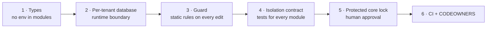

# Building on Rose with AI agents

Rose assumes that much of the code built on top of it will be written by AI coding
agents. The kit is arranged so that the *easy* way to add a feature is also the safe
way, and so that drifting away from the security model is noticed immediately, by the
agent itself, and again by a human.

There are six layers. Each catches what the one before can miss.



## 1. Types: the context has nothing dangerous in it

A module handler receives a `ModuleContext`: the tenant's database, the tenant's
encryption, audit, and the validated request. There is no `env`, no raw binding, no
request object, and `TenantContext` can not be constructed by application code.
`defineModule` requires a `permission` on every route and an `isolationProbe` on every
module; leaving either out is a compile error.

## 2. Runtime boundary

Even code that ignores every convention only holds a handle to one tenant's SQLite
database. See [tenancy-and-isolation.md](tenancy-and-isolation.md).

## 3. The guard (`pnpm guard`)

`scripts/guard.mjs` is a dependency-free static checker. It runs:

- after **every file edit** an agent makes (Claude Code `PostToolUse` hook, checking just
  that file, with the findings fed straight back to the agent);
- when the agent tries to **finish** (`Stop` hook: the whole repo must be clean);
- in the git `pre-commit` hook, in `pnpm verify`, and in CI.

Each finding states the rule, the location, **why the rule exists** and **how to fix it
properly**, because an agent that understands the reason fixes the cause instead of
silencing the symptom.

| Rule | Stops |
|---|---|
| `raw-sql` | `.prepare(` outside `packages/core` |
| `module-env` | `env`, bindings, `cloudflare:*` imports or `fetch` inside a module |
| `tenant-binding` | `TENANT_DO`, `idFromName`, `storage.sql` outside the core |
| `cf-workers-import` | `cloudflare:workers` outside the core and the DO declaration |
| `platform-import` | The cross-tenant operator API or core internals imported into the tenant app or UI |
| `module-structure` | Unregistered modules, missing `isolationProbe`, missing tests, a removed/skipped isolation suite |
| `sql-interpolation` | Values interpolated or concatenated into SQL |
| `list-limit` | List queries without `LIMIT`, or above 100 |
| `forbidden-api` | `dangerouslySetInnerHTML`, `innerHTML =`, `eval`, `new Function`, `document.write` |
| `insecure-random` | `Math.random()` in worker/core code |
| `log-sensitive` | Tokens, codes, keys, passwords in logs |
| `storage-sensitive` | Credentials in web storage; script access to cookies |
| `ui-external-fetch` | The UI calling anything but its own API |
| `target-blank` | New-tab links without `rel="noopener"` |
| `admin-isolation` | Any tenant storage binding on the operator worker |
| `csp` | Weakening `script-src` or `frame-ancestors` |
| `secret-in-repo` | Keys, tokens, private keys, tracked `.dev.vars`/`.env` |
| `spdx` | Missing license header |
| `protected-file` | Unapproved change to the security core (next section) |

**Exceptions** are explicit and visible:

```ts
// guard-allow: module-env webhook to the customer's own configured URL, validated in settings
await fetch(url, …);
```

The comment must name the rule and give a reason. Every run prints the full list of
exceptions, and the PR template asks for them, so they can not accumulate unseen.
Exceptions never apply to the protected-file lock.

## 4. The isolation contract

`apps/app/worker/test/isolation.test.ts` runs the cross-tenant checks against every
module in the manifest ([testing.md](testing.md#the-isolation-contract)). An agent adding
a module does not need to remember to write isolation tests, and can not forget to.

## 5. The protected core and `guard.lock.json`

These paths are the security core:

```
packages/core/src/**          (except testing/)
packages/core/migrations/**
apps/*/worker/test/isolation.test.ts
apps/*/public/_headers
scripts/guard.mjs
.github/workflows/**   .githooks/**   .claude/settings.json   CODEOWNERS
```

`guard.lock.json` holds a SHA-256 of each. If any is added, changed or deleted, the guard
fails with `protected-file` until a **human** reviews the diff and runs:

```sh
pnpm guard:approve
```

which rewrites the lock. The lock's diff then appears in the pull request, where
CODEOWNERS requires the maintainer's review. Modifying a migration that is already in
the lock prints a loud warning: shipped migrations are immutable.

For agents this means: you may propose a core change, but you can not make it silently.
Explain what you changed and why, and ask the user to approve. `--approve` refuses to run
when it detects an agent environment unless a human sets `ROSE_GUARD_APPROVE=human-reviewed`,
and Claude Code asks for permission before running it.

## 6. Agent configuration shipped in the repo

| File | Purpose |
|---|---|
| `AGENTS.md` / `CLAUDE.md` | The invariants (with reasons), the repo map, the module recipe, definition of done |
| `.claude/settings.json` | Permission prompts before editing protected paths, deploying, pushing or touching secrets; `.dev.vars`/`.env` are unreadable; the guard hooks |
| `.claude/hooks/guard.mjs` | Adapter from hook events to the guard |
| `.claude/skills/add-module` | Step-by-step recipe for a new module |
| `.claude/skills/security-review` | Checklist the agent runs before finishing |
| `.github/pull_request_template.md` | The same checklist for the human reviewer |

Other agents (Cursor, Codex, Copilot, …) read `AGENTS.md`; wire `node scripts/guard.mjs
--quick <file>` into their equivalent of a post-edit hook. The git hooks and CI apply to
everyone regardless of tool.

## Honest limits

- **The guard is a tripwire, not a proof.** It matches patterns. Code can be written to
  evade it (aliasing a name, building a string in two steps, naming an unsafe value
  `order`). It exists to catch honest mistakes and drift early, with an explanation.
  The guarantees come from layers 1, 2 and 4.
- **The SQL rule trusts names.** `${w.sql}` and `${order}` are allowed because the
  documented pattern builds them from constants and `orderBy()`; the guard does not
  verify how a variable with that name was produced.
- **Tests prove what they exercise.** The isolation contract covers create/list/read/
  update/delete through the probe. A module with an unusual route (an export, a search
  endpoint with its own storage) should add its own cross-tenant test.
- **Hooks are local.** Someone can commit with `--no-verify` or disable hooks. CI and
  branch protection are the enforcement that can not be skipped; turn on required status
  checks and CODEOWNERS review on `main`.
- **The lock detects change, not intent.** It guarantees a human is asked; the quality of
  that review is up to the human.
- **Module `migrations` arrays are not locked**, only the core SQL files are. Editing a
  shipped module migration is caught by review, not by the guard.
- The UI has no automated tests yet; UI rules in the guard cover injection and data
  egress, not behaviour.
