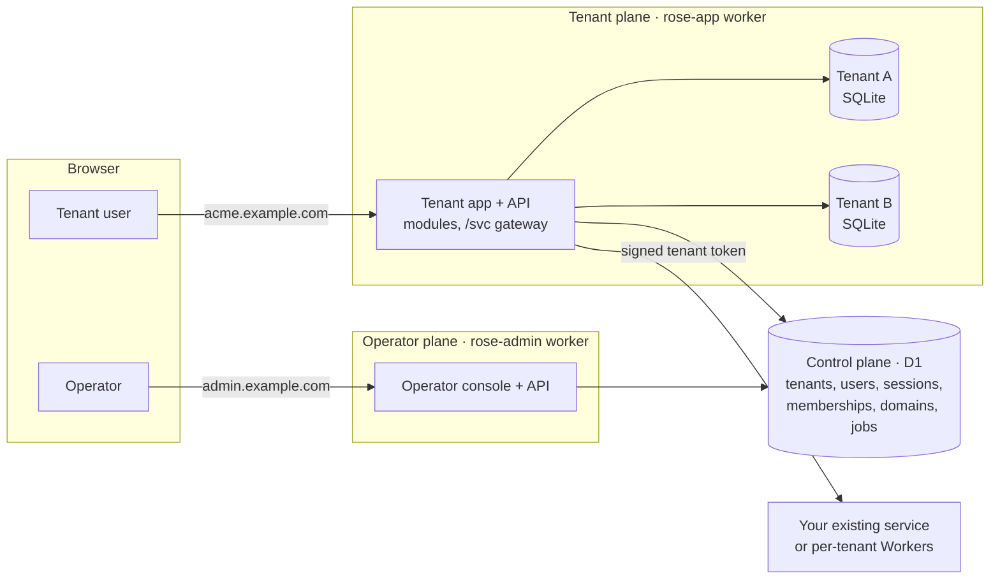
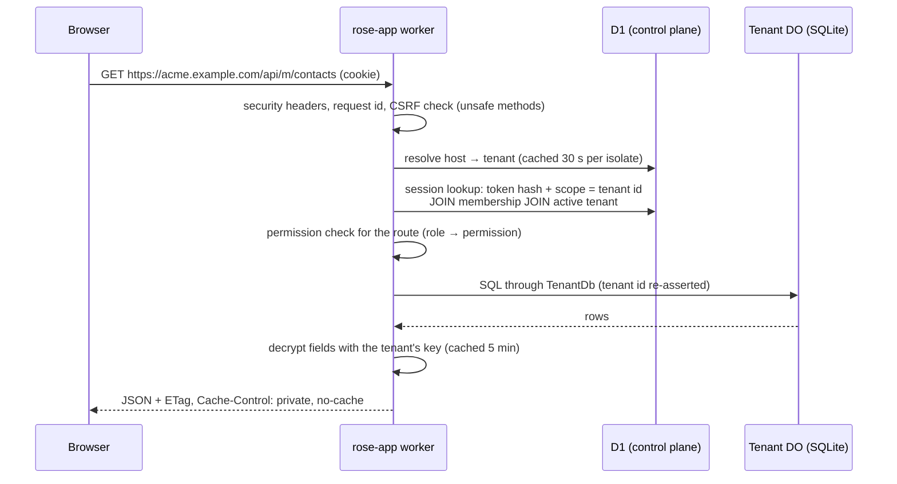

# Architecture

Rose is two Cloudflare Workers, one shared control-plane database, and one private
database per tenant.

## The two planes

| | Tenant plane (`apps/app`) | Operator plane (`apps/admin`) |
|---|---|---|
| Who uses it | Your customers | You (platform staff) |
| Host | `<slug>.<base>` and customer domains; `<base>` itself for signup | `admin.<base>` |
| Bindings | D1 `DB`, Durable Object `TENANT_DO`, rate limiter, optional `DISPATCHER` | D1 `DB`, rate limiter. **Nothing else.** |
| Master key | Its own `ROSE_MASTER_KEY` (wraps tenant data keys) | A different `ROSE_MASTER_KEY` (sign-in codes, stored connection tokens) |
| Can read tenant business data | Only for the tenant the request host resolves to | **No.** There is no binding and no key that would allow it |

The operator worker manages tenants purely through control-plane rows. Deleting a
tenant, for example, marks the row `deleting` and queues a job; the *tenant* worker
runs the job and destroys the storage. The planes share only D1 and the queue that
carries job ids (never data).

## Where data lives

**Control plane (D1, `packages/core/migrations/`)** — identity and routing only:
`tenants`, `tenant_domains`, `users`, `memberships`, `invitations`, `operators`,
`sessions`, `login_codes`, `handoffs`, `passkeys`, `webauthn_challenges`, `jobs`,
`platform_audit`, `platform_settings`.

**Tenant database (Durable Object SQLite, one per tenant)** — everything the tenant owns:
module tables (for example `contacts`), the tenant's `audit_log`, its `api_keys`, and its
wrapped data-encryption key.

### Why a database per tenant

Most multi-tenant leaks are one missing `WHERE tenant_id = ?`. Rose removes that class of
bug instead of policing it: a tenant's rows are in a SQLite database that only that
tenant's Durable Object can open. A query that forgets a filter still only sees one
tenant. Further properties:

- The object is addressed by `idFromName(tenantId)` and pins that id in its own storage
  on first use; every call re-asserts it (`TenantDurableObject.assertTenant`).
- Deleting a tenant is `storage.deleteAll()`: one operation, no orphaned rows, and the
  wrapped data key goes with it (crypto-shredding).
- Per-tenant schema migrations run automatically the next time the object starts.
- Each tenant gets its own compute and storage limits (10 GB per object at the time of
  writing); one noisy tenant does not slow another's queries.

Trade-offs: no cross-tenant SQL (by design; aggregate in the control plane if you need
platform analytics), and each query is one RPC to the object.

## Request lifecycle (tenant plane)

Key points, each implemented in `packages/core/src/tenant-app.ts`:

1. **The host decides the tenant.** `resolveHost` uses only the routed hostname: never a
   header, query parameter, body field or token.
2. **A session is valid for exactly one scope.** The lookup includes the tenant id from
   step 1, a live membership and an active tenant, so removing a member or suspending a
   tenant takes effect on the next request.
3. **A bearer token disables cookies for that request.** API keys are verified inside
   the tenant's own database.
4. **Modules receive a `ModuleContext`** already bound to the tenant. It has no `env`.

## Background jobs

Jobs are rows in the control-plane `jobs` table (`packages/core/src/control/jobs.ts`).
Queuing a job also sends its id to a Cloudflare Queue (`rose-app-jobs` or
`rose-admin-jobs`), which wakes the worker that owns that job type at once. The worker
claims the job with an atomic compare-and-set, runs it, and schedules retries itself with
a delayed message and exponential backoff (five attempts). The job row is the source of
truth: a lost message costs time, not the job, because an hourly cron in each worker
sweeps for due jobs and for jobs left running by a worker that died. The operator worker
can send to the tenant worker's queue, but a message only ever names a job id.

| Job | Runs in | Does |
|---|---|---|
| `tenant.purge` | tenant worker | Destroys the tenant database, then its control-plane rows |
| `m.<module>.<name>` | tenant worker | A module job, bound to the tenant that queued it |
| `domain.verify` | operator worker | Registers a custom hostname with Cloudflare and polls until active |

The UI polls `/api/jobs` (faster while something is running). There is no SSE/WebSocket
push; see [known limits](#known-limits).

## Packages

| Path | Role |
|---|---|
| `packages/core` | The security core: tenancy, auth, crypto, HTTP hardening, module system, jobs. **Protected** (see [agents.md](agents.md)). |
| `packages/ui` | Shared React shell and components used by both SPAs. See [ui.md](ui.md). |
| `apps/app` | Tenant worker + SPA. Your product's modules live in `apps/app/worker/modules/`. |
| `apps/admin` | Operator worker + SPA. |
| `examples/upstream-service` | A service that verifies Rose's tenant token. |

`@rose/core` has three entry points: `@rose/core` (safe for apps and modules),
`@rose/core/platform` (cross-tenant operator API; admin worker only, enforced by
`pnpm guard`), and `@rose/core/testing`.

## Known limits

- Job progress is polled, not pushed.
- The host→tenant cache is per isolate with a 30-second TTL: a rename, a new custom
  domain or a deleted tenant can take up to 30 s to be reflected for anonymous requests
  in other isolates. Authenticated requests re-check tenant status on every call.
- The Workers rate limiter counts per Cloudflare location, not globally. The hard limits
  on sign-in codes (attempts, codes per window) are enforced in D1 and are global.
- No billing, no file storage helper (R2) and no per-tenant KV helper yet.
- Email search inside modules is exact-match (blind index); see [encryption.md](encryption.md).
- The production setup and deploy scripts have been exercised with `--dry-run` only.
