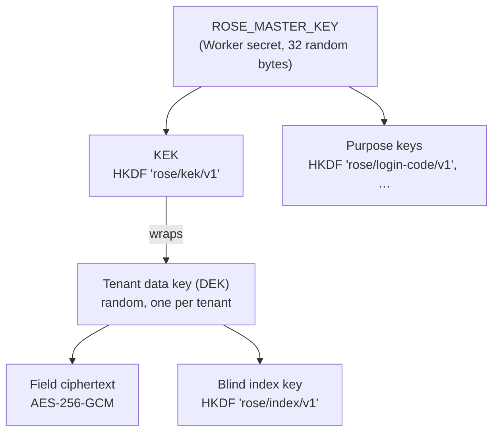

# Encryption

Everything is WebCrypto (AES-256-GCM, HMAC-SHA-256, HKDF-SHA-256). There are no custom
primitives. Code: `packages/core/src/crypto.ts`.

## Key hierarchy



- **Master key**: one per worker, set with `wrangler secret put`. The tenant worker's and
  the operator worker's keys are different, so the operator plane can not unwrap tenant
  data keys even with database access.
- **Tenant data key (DEK)**: created inside the tenant's Durable Object on first use,
  stored there wrapped by the KEK with the tenant id as authenticated data. It never
  leaves the worker, and unwrapped keys are cached per isolate for 5 minutes.
- **Field encryption**: `ctx.crypto().encrypt(value, "table.column")`. The additional
  authenticated data is `rose:field:<tenantId>:<table.column>`, so a ciphertext copied to
  another column or another tenant fails to decrypt. Format: `v1.<iv>.<ciphertext+tag>`,
  random 96-bit IV per value.

## Using it in a module

```ts
const c = await ctx.crypto();
const sealed = await c.encrypt(body.email, "contacts.email");   // store this
const index  = await c.blindIndex(body.email, "contacts.email"); // store next to it for lookups
const plain  = await c.decrypt(row.email_enc, "contacts.email");
```

Use the same `table.column` string for a column everywhere. Changing it makes existing
values undecryptable.

## Searching encrypted data: blind indexes

`blindIndex` is a keyed hash (HMAC with a per-tenant key) of the normalised value
(trimmed, lower-cased). Storing it beside the ciphertext allows `WHERE email_idx = ?`.

Trade-offs to know:

- **Exact match only.** No prefix, substring or sort. The Contacts module searches names
  with `LIKE` (plaintext column) and emails by exact match.
- **Equality leaks.** Two rows with the same value have the same index, so someone with
  database access learns "these rows share an email", not the email. Do not blind-index
  low-entropy fields (status, yes/no, small enumerations): they can be guessed.
- Indexes differ per tenant, so they can not be correlated across tenants.

## What is encrypted, and what is not

| Data | Protection |
|---|---|
| Module fields you pass through `ctx.crypto()` (Contacts: email, notes) | AES-256-GCM, tenant key |
| Operator connection tokens (Cloudflare API token, GitHub token) | AES-256-GCM, key derived from the operator master key |
| Session tokens, API key secrets, handoff tokens | Not reversible: only SHA-256 is stored (256-bit random inputs) |
| Email sign-in codes | Keyed HMAC bound to scope and email |
| Member emails and names, tenant names and slugs, audit entries | **Plaintext** in D1 / the tenant database |
| Module columns you do not encrypt (Contacts: name, company, status) | **Plaintext** in the tenant database |

Why member emails are plaintext: they are the sign-in identifier and operators and
admins need to search member lists. Cloudflare encrypts D1 and Durable Object storage at
rest; application-level encryption is reserved for data whose exposure in a database
dump would matter most. Encrypt anything in your modules that is personal or secret and
does not need `LIKE` search or sorting.

Audit entries are plaintext: do not put sensitive values in `ctx.audit()` metadata.

## Rotating the master key

1. `wrangler secret put ROSE_MASTER_KEY_PREVIOUS` with the **current** key value.
2. `wrangler secret put ROSE_MASTER_KEY` with a new key (`openssl rand -base64 32`).
3. Each tenant's data key is re-wrapped under the new key the next time it is used
   (`TenantDurableObject.dataKey`). Field ciphertext is untouched, so no bulk rewrite.
4. Remove `ROSE_MASTER_KEY_PREVIOUS` only when every tenant has been active since the
   rotation. There is no report of "tenants not yet re-wrapped" in this version; a tenant
   that was never touched in between would lose access to its key. Keep the previous key
   until you are sure, or touch each tenant with a script first.

Operator worker: rotating its key invalidates outstanding sign-in codes (harmless) and
makes stored connection tokens undecryptable; re-enter them in Setup → Connections.

**Losing the tenant worker's master key means losing every encrypted field.** Back it up
in your secret manager when `pnpm setup --production` creates it (the script never prints
it, so set it yourself first if you need a copy:
`openssl rand -base64 32 | tee >(wrangler secret put ROSE_MASTER_KEY)`).

## Deletion is crypto-shredding

Purging a tenant calls `storage.deleteAll()` on its Durable Object. That removes the data
and the only copy of the wrapped data key in one step, so any ciphertext that survived in
a backup or log is permanently unreadable.
