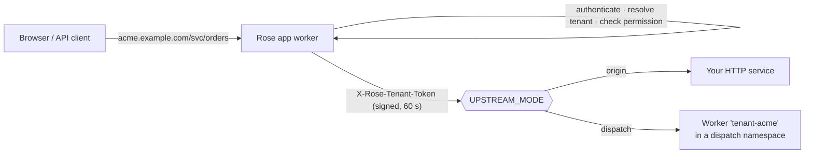

# Turning an existing service into a multi-tenant SaaS

Rose can sit in front of a service you already have. Rose owns sign-up, sign-in, tenants,
roles, API keys, audit and custom domains; your service receives requests that are
already authenticated and labelled with the tenant.

It builds on [Cloudflare for Platforms](https://developers.cloudflare.com/cloudflare-for-platforms/):
**Cloudflare for SaaS** (custom hostnames) for customer domains and, optionally,
**Workers for Platforms** (dispatch namespaces) for per-tenant code.



## The gateway

Everything under `/svc/*` on a tenant host is forwarded (`packages/core/src/gateway.ts`)
after the caller is authenticated (session or API key) and holds `service:use`
(all roles by default).

- **Forwarded request headers** (allow-list): `accept`, `accept-language`,
  `content-type`, `if-none-match`, `if-modified-since`, `range`, `idempotency-key`.
  Cookies, `Authorization` and any client-sent `X-Rose-*` header are dropped.
- **Added**: `X-Rose-Tenant-Token` (HS256 JWT signed with `UPSTREAM_SIGNING_SECRET`,
  60-second lifetime) and `X-Rose-Tenant-Id`.
- **Stripped from the response**: `Set-Cookie`, `Content-Security-Policy`,
  `Strict-Transport-Security`, CORS allow headers. `Cache-Control: no-store` is set.
- The path keeps everything after `/svc`; redirects are passed through, not followed.

Token claims: `iss: "rose"`, `aud: "upstream"`, `tid`, `tslug`, `sub`, `sub_type`
(`user`|`api_key`), `role`, `iat`, `exp`.

## Origin mode: one existing service for all tenants

App worker configuration:

```
UPSTREAM_MODE=origin
UPSTREAM_ORIGIN=https://internal-api.example.net
UPSTREAM_SIGNING_SECRET=<set by pnpm setup>          # wrangler secret
```

Your service must, on every request:

1. verify the token's signature, `exp`, `iss`, `aud` with the shared secret, pinning HS256;
2. use `tid` from the verified token as the tenant key for all data access;
3. ignore every other source of tenant identity.

[`examples/upstream-service`](../examples/upstream-service) is a complete, dependency-free
implementation with tests. Make the origin unreachable except through Rose where you can
(Cloudflare Tunnel, private networking); the token keeps you safe if it is not.

Your service now needs a tenant column or a database per tenant on its side. Rose tells
it *who*; it can not retrofit isolation into the service's own storage.

## Dispatch mode: a Worker per tenant (Workers for Platforms)

```
UPSTREAM_MODE=dispatch
```

and in `apps/app/wrangler.jsonc`:

```jsonc
"dispatch_namespaces": [{ "binding": "DISPATCHER", "namespace": "rose-tenants" }]
```

Rose calls `env.DISPATCHER.get("tenant-<slug>")` and forwards the same signed request.
Upload one script per tenant to the namespace, named `tenant-<slug>` (for example with
`wrangler deploy --dispatch-namespace rose-tenants --name tenant-acme`). This gives each
tenant isolated code and bindings, and is the route to letting customers run their own
logic. Notes:

- Rose does not upload or manage tenant scripts yet; provisioning them is up to you
  (a natural place is a job triggered when a tenant is created).
- A tenant with no script gets the dispatcher's error as a 5xx.
- Dispatch mode needs the Workers for Platforms plan and has not been exercised against
  a live account in this repository's tests. Origin mode is covered by tests.

## Custom domains (Cloudflare for SaaS)

Operators add a customer domain to a tenant in the console (Tenants → a tenant →
Domains, or Domains). With the Cloudflare connection configured in Setup:

1. The operator worker creates a **custom hostname** on your zone and stores the DNS
   records the customer must add.
2. The `domain.verify` job polls every 30 seconds until hostname and certificate are
   active, then marks the domain `active`. Only active domains resolve to a tenant.
3. The customer points a CNAME at your fallback origin.

One-time zone setup (not automated): enable Cloudflare for SaaS on the zone, set a
fallback origin, and make sure a Worker route covers custom hostnames (a `*/*` route on
the zone for `rose-app`). The API token needs *SSL and Certificates: Edit* and
*Zone: Read* on that zone. It is stored encrypted.

Without a Cloudflare connection: in development a domain is activated immediately so you
can test with a hosts-file entry; in production it is marked failed with a pointer to
Setup. Domains inside your own base domain, and domains already attached to another
tenant, are rejected.

When a tenant moves to a custom domain, sessions and passkeys are per host: people sign
in again with an email code and re-add a passkey there.

## Module or gateway?

| Use | When |
|---|---|
| A **module** (`apps/app/worker/modules/`) | New functionality. Data lives in the tenant's private database with encryption, audit and the isolation tests for free. |
| The **gateway** | Functionality that already exists as a service, or must run elsewhere. |

They compose: many products start with the gateway and move features into modules.
